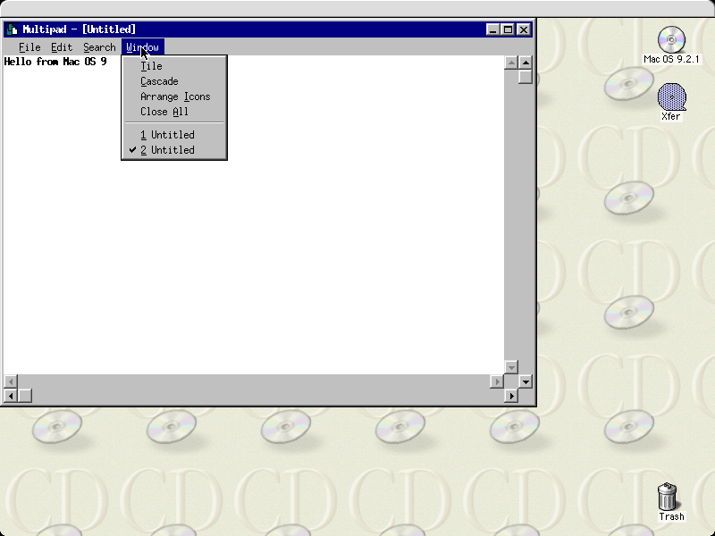
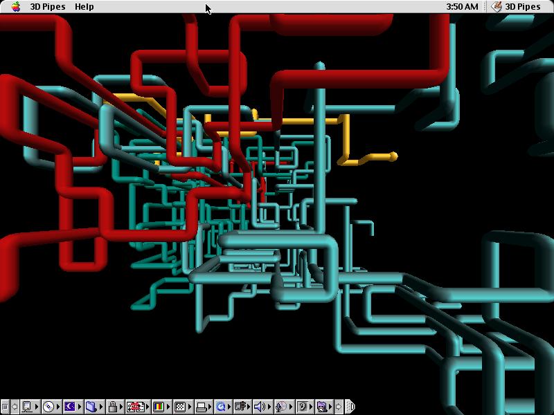

---
hide:
  - navigation
---

# clang-retro

clang-retro brings a current clang and LLVM to 8, 16 and 32-bit systems
that upstream LLVM does not support, with a C library, C++ and the
system's own API for each. Every repository has its own documentation
site. For the recent work, see [What is new](news.md).

```sh
clang --target=i8086-pc-msdos -Os hello.c -o hello.exe        # MS-DOS
clang --config=win31.cfg -Os hello.c -o hello.exe             # Windows 3.1
clang --config=win95.cfg -O2 hello.c -o hello.exe             # Windows 95
clang --target=i386-pc-os2 -Os hello.c -o hello.exe           # OS/2
python3 tools/macapp.py --cpu 68k -o Hello.bin hello.c       # Mac OS, 68k
clang --target=powerpc-apple-macosx10.4 -O2 hello.c -o hello  # Mac OS X 10.4
clang --target=m68k-amigaos -O2 hello.c -o hello              # AmigaOS
clang --target=m68k-atari-tos -O2 hello.c -o hello.tos        # Atari ST
clang --target=i8086-unknown-cpm -Os hello.c -o hello.cmd     # CP/M-86
clang --target=z80-unknown-cpm -Os hello.c -o hello.com       # CP/M-80
mos-c64-clang -Os hello.c -o hello.prg                        # Commodore 64
clang --target=mips-sgi-irix6.5 -static hello.c -o hello      # SGI IRIX
```

<div class="grid" markdown>





</div>

## Getting started

Most people only need the toolchain package, which has the compiler, the
linkers and a sysroot for every target below: see
[the toolchain package](https://clang-retro.github.io/dos-sdk/toolchain/).

| Platform | Target triple | Documentation |
| --- | --- | --- |
| MS-DOS (8086 and up) | `i8086-pc-msdos` | [dos-sdk](https://clang-retro.github.io/dos-sdk/) |
| Windows 1.x, 2.x and 3.x | `i8086-pc-win16` | [win16-sdk](https://clang-retro.github.io/win16-sdk/) |
| Win32s, Windows NT 3.1 to 11, 95/98/ME, VxDs and drivers | `i386-pc-windows*-gnu`, `x86_64-w64-mingw32` | [win32-sdk](https://clang-retro.github.io/win32-sdk/) |
| OS/2 1.x, 2.x to 4.x, ArcaOS | `i8086-pc-os2`, `i386-pc-os2` | [os2-sdk](https://clang-retro.github.io/os2-sdk/) |
| Classic Mac OS, System 0.1 to 9 | `m68k-apple-macos`, `powerpc-apple-macos9` | [mac-sdk](https://clang-retro.github.io/mac-sdk/) |
| Mac OS X 10.0 to 10.5, PowerPC and Intel | `powerpc-apple-macosx10.4`, `i386-apple-macosx10.4` | [dos-sdk: Mac OS X](https://clang-retro.github.io/dos-sdk/mac/macosx/) |
| AmigaOS, Kickstart 1.3 to 3.x | `m68k-amigaos` | [amiga-sdk](https://clang-retro.github.io/amiga-sdk/) |
| Atari ST, STe, TT and Falcon | `m68k-atari-tos` | [atari-sdk](https://clang-retro.github.io/atari-sdk/) |
| CP/M-86, CP/M-80 (Z80, 8080 and 8085) | `i8086-unknown-cpm`, `z80-unknown-cpm`, `i8080-unknown-cpm` | [cpm-sdk](https://github.com/clang-retro/cpm-sdk) |
| 6502 computers and consoles (C64, Apple II, NES, Atari and more) | `mos` | [mos-sdk](https://github.com/clang-retro/mos-sdk) |
| SGI IRIX, Solaris (SPARC and x86), FreeBSD and NetBSD (x86) | `mips-sgi-irix`, `sparc-sun-solaris`, `i386-pc-solaris`, `i386-unknown-freebsd`, `i386-unknown-netbsd` | [unix-sdk](https://clang-retro.github.io/unix-sdk/) |

## Libraries

| Repository | What it is | Documentation |
| --- | --- | --- |
| [mfc](https://github.com/clang-retro/mfc) | The MFC API for Win32, 16-bit Windows, classic Mac OS, Mac OS X, macOS and Linux | [mfc](https://clang-retro.github.io/mfc/) |
| [softgl](https://github.com/clang-retro/softgl) | A software OpenGL 1.1 renderer, for systems with no OpenGL | [softgl](softgl.md) |
| [unicows](https://github.com/clang-retro/unicows) | A free `unicows.dll`, for Unicode programs on Windows 95, 98 and ME | [unicows](https://github.com/clang-retro/unicows) |

## The toolchain

| Repository | What it is | Documentation |
| --- | --- | --- |
| [llvm](https://github.com/clang-retro/llvm) | LLVM and clang with the 8086, Z80 and 6502 backends, the retro targets and their drivers | [llvm](https://clang-retro.github.io/llvm/) |
| [picolibc](https://github.com/clang-retro/picolibc) | The C library, with a layer for each system | [picolibc](https://clang-retro.github.io/picolibc/) |
| [JWlink](https://github.com/clang-retro/JWlink) | The linker for DOS, Win16, OS/2, CP/M-86 and VxD programs | [JWlink](https://clang-retro.github.io/JWlink/) |
| [dos-sdk](https://github.com/clang-retro/dos-sdk) | The DOS sysroot, the toolchain packages and the CI that ties it all together | [dos-sdk](https://clang-retro.github.io/dos-sdk/) |

## License

The SDKs are free software under the GNU Affero General Public License,
version 3 only. The forks of LLVM, picolibc and JWlink keep their
upstream licenses. Contributors keep the copyright in their own work and
sign off their commits under the Developer Certificate of Origin.
