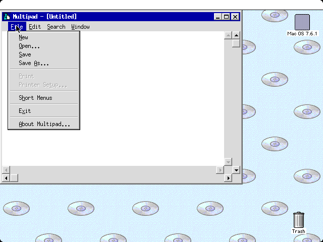
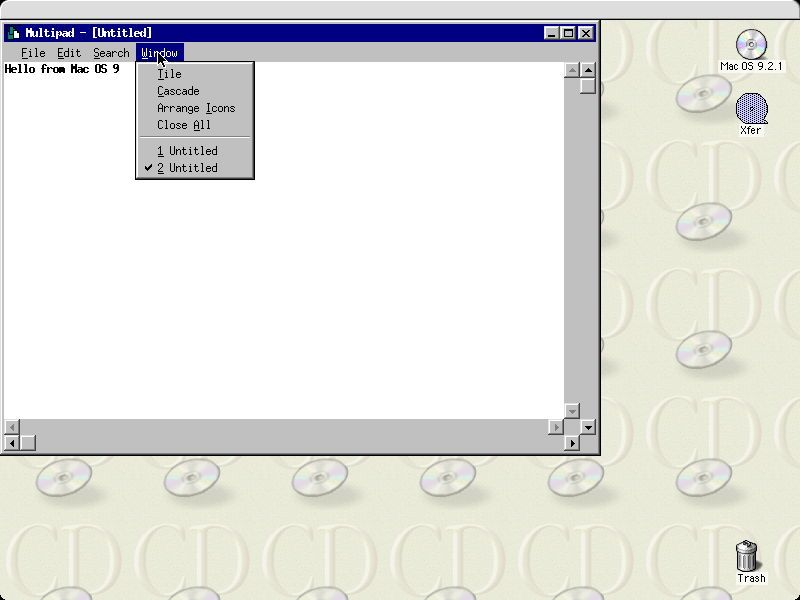
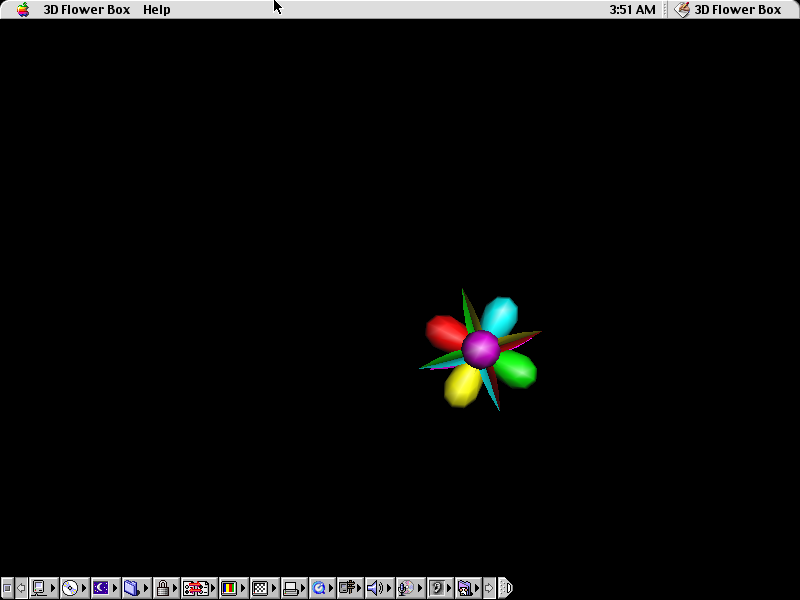
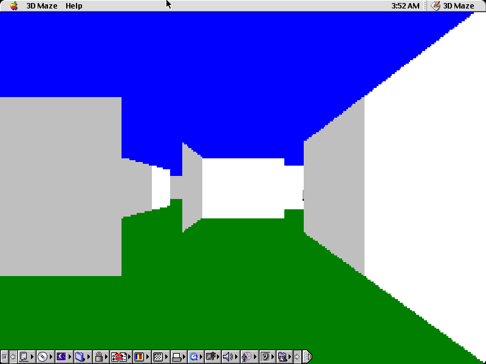
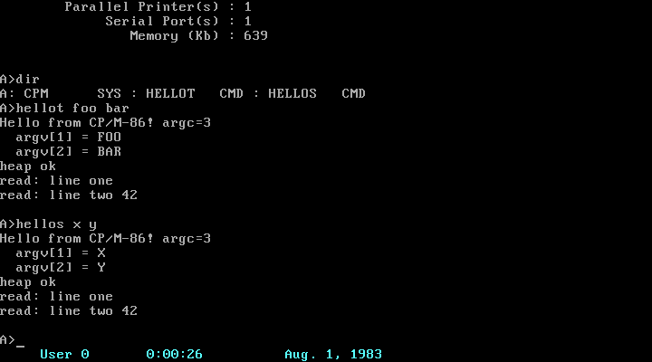

# What is new

This page gives a summary of the work in each repository. The newest
work is first. Each item links to the documentation, where you can find
the full information.

## November 2026

### MFC and C++ on the classic Mac OS

clang-retro MFC now builds for the classic Mac OS, on 68k and PowerPC.
Programs that use MFC or the Win32 API operate on System 7 to Mac OS 9.
The portable layer draws each window and copies it to the screen with
`CopyBits`. On a Mac without Color QuickDraw, the layer dithers the
window to black and white.

The samples of the Win32 SDK build without changes to their files:
MULTIPAD and the five OpenGL screen savers (3D Flying Objects, Flower
Box, Maze, Pipes and 3D Text). We ran them on System 7.6.1 and on Mac OS
9.2.1 in QEMU.

mac-sdk has these new parts:

- C++ for 68k and PowerPC: exceptions, RTTI and libstdc++, with
  libunwind.
- The C library: file information, folders, POSIX threads, sockets
  (MacTCP), pipes, `thread_local` and more POSIX functions.
- OpenGL through Apple OpenGL and AGL on PowerPC.
- QuickDraw 3D on PowerPC, through Quesa. Quesa is a QuickDraw 3D that
  draws with OpenGL.
- A faster float library for the 68000. The single-precision helpers
  are now in 68000 assembly. Division is 7.9 times faster, and
  multiplication is 2.2 times faster.

On 68k Macs, OpenGL uses [softgl](softgl.md), the new software renderer.

See [mac-sdk](https://clang-retro.github.io/mac-sdk/) and
[MFC on the classic Mac OS](https://clang-retro.github.io/mfc/macos-classic/).

### Win32 SDK samples on Mac OS X and macOS

The same samples of the Win32 SDK build for Mac OS X and for macOS:

- Mac OS X 10.4 and 10.5, as fat programs for PowerPC and Intel. The
  windows use Cocoa, and OpenGL uses `OpenGL.framework`.
- macOS 11 and later, as universal programs for Intel and Apple
  silicon.

For Mac OS X 10.4, the toolchain now has thread-local variables,
atomics and libc++ with threads. CI builds the runtime as fat libraries
for PowerPC and Intel.

See [MFC on Mac OS X](https://clang-retro.github.io/mfc/macosx-10.4/)
and [Win32 SDK samples](https://clang-retro.github.io/mfc/sdk-samples/).

### 16-bit Windows

MFC now builds for 16-bit Windows, in the large memory model. It has
the core classes and the window classes of MFC 2.5:

- Frame windows, MDI, dialogs and the common dialogs.
- Document/view, printing and print preview.
- Toolbars, status bars and dialog bars, with docking.
- OLE 2: automation, containers, servers, data transfer and drag and
  drop.

win16-sdk and the compiler also have these new parts:

- A QuickWin console window. Give `-mquickwin` and a program with
  `main()` gets a window for its standard input and output.
- C++ exceptions in DLLs, in all memory models.
- The OLE 2, Video for Windows, WinG, ODBC and MAPI headers.
- DWARF debug information for 16-bit OMF objects.
- Display minidrivers and installable drivers (`.DRV`).

See [MFC on 16-bit Windows](https://clang-retro.github.io/mfc/win16/)
and [win16-sdk](https://clang-retro.github.io/win16-sdk/).

### softgl, a software OpenGL renderer

softgl is a new repository. It is a software renderer for OpenGL 1.1,
with GLU 1.3. It operates on a 68000 without a floating-point unit.
MFC uses it for the `wgl` functions on systems that have no OpenGL.
See [softgl](softgl.md).

### CP/M and the 6502

- [cpm-sdk](https://github.com/clang-retro/cpm-sdk) is new. It has
  sysroots for CP/M-86 and for CP/M-80 on the Z80, 8080 and 8085. The
  compiler has a new Z80 and 8080 backend.
- [mos-sdk](https://github.com/clang-retro/mos-sdk) is new. It is the
  llvm-mos SDK for 6502 computers and consoles, with the clang-retro
  build and tests. The compiler has the llvm-mos 6502 backend.

### UNIX

[unix-sdk](https://clang-retro.github.io/unix-sdk/) is new. It has
sysroots for static programs on these systems:

- SGI IRIX 5.3 and 6.x (o32, n32 and 64).
- Solaris 2.5 to 11.4, on 32-bit SPARC and on x86.
- FreeBSD 3.0 and later, and NetBSD 1.5 and later, on 32-bit x86.

The C library is picolibc, with a layer that makes the system calls
directly.

### Windows drivers and Win32

- win32-sdk can now build VxDs for Windows 3.1, 95, 98 and ME, and
  kernel-mode drivers for Windows NT.
- The compiler can use the C++ ABI of Visual C++ 4.0 to .NET 2003.
- `#import` of a type library operates as in Visual C++.
- Each Windows sysroot has libstdc++ from GCC 15.2.0.
- MFC has ATL and WTL, and the portable layer runs MFC programs on
  Linux and macOS.
- [unicows](https://github.com/clang-retro/unicows) is a new, free
  `unicows.dll`. It lets Unicode programs operate on Windows 95, 98 and
  ME.

### Fixes

- picolibc: `malloc` on AmigaOS no longer assumes that `AllocMem`
  gives memory with 8-byte alignment. Before the fix, a block could
  overwrite the next block.
- llvm: a fix for the 68k code generator is in review. `movea.w`
  extends the sign of a 16-bit value. Thus an address from `0x8000` to
  `0xFFFF` became an incorrect value. The fix uses `move.l` for these
  addresses.
