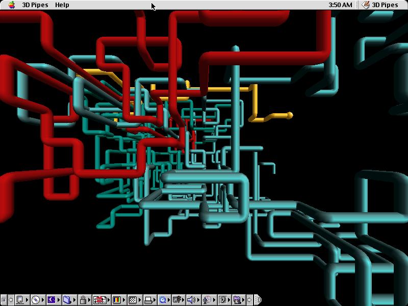

# softgl

softgl is a software renderer for OpenGL 1.1. It copies the design of
the "generic implementation" of `opengl32.dll` on Windows NT. GDI uses
that implementation when no graphics driver for OpenGL is installed.
Thus OpenGL programs for Windows NT and Windows 95 operate without
changes.

softgl operates on a 68000 without a floating-point unit. It is written
in C99 and has no dependency on a window system.

- Source: [clang-retro/softgl](https://github.com/clang-retro/softgl)
- Full documentation:
  [docs/software-opengl.md](https://github.com/clang-retro/softgl/blob/main/docs/software-opengl.md)



## Where it is used

clang-retro MFC uses softgl for the `wgl` functions on systems that have
no OpenGL of their own. MFC has softgl as a submodule.

| System | OpenGL under the `wgl` functions |
| --- | --- |
| Linux | softgl |
| Classic Mac OS, 68k | softgl |
| Classic Mac OS, PowerPC | Apple OpenGL, through AGL |
| Mac OS X and macOS | `OpenGL.framework`, through CGL |

On the Apple systems, the Apple renderer has the function of the
installable client driver (ICD) of Windows.

## What it does

- OpenGL 1.1, as `opengl32.dll` of Windows NT 4.0 gives it.
  `glGetString(GL_RENDERER)` gives `clang-retro Generic`.
- The extensions `GL_WIN_swap_hint`, `GL_EXT_bgra`,
  `GL_EXT_paletted_texture` and `GL_EXT_vertex_array`.
- Immediate mode, vertex arrays, display lists and evaluators.
- Lighting with eight lights, fog, textures with mipmaps, stencil,
  blending and the accumulation buffer.
- Selection, feedback and color index mode.
- GLU 1.3 from the SGI reference code: quadrics, tessellation and
  NURBS.

## Speed on the 68000

The 68000 has no floating-point unit and no 32-bit multiply
instruction. softgl has these designs for the 68000:

- It calculates the geometry in `float`, one time for each vertex.
- The rasterizer uses fixed-point values for each span.
- Color, blend and texture operations multiply only 16-bit values.
  Each multiply is one `muls` or `mulu` instruction.
- The depth buffer has 16 bits for each pixel on the 68k.

Most of the remaining time is in the floating-point helpers of the
runtime library. mac-sdk now has faster helpers for single precision,
in 68000 assembly. Thus softgl is faster on the 68k Mac without changes.
See [soft float on the 68000](https://clang-retro.github.io/mac-sdk/softfloat/).

## Build and test

```sh
make check
```

To use a cross compiler, set `CC`, `CXX`, `CFLAGS` and `AR`. For
example, for AmigaOS:

```sh
make CC="clang --config=amiga.cfg" CXX="clang++ --config=amiga.cfg" AR=llvm-ar
```

CI also compiles softgl for AmigaOS and for Atari TOS with the
clang-retro toolchain.

## Limits

- softgl does not compile for 16-bit x86 targets, because a context is
  larger than 64 KB.
- The OpenGL 1.2 functions are not available.
- The width and the height of a texture must be powers of two.
- Points, lines and polygons have no antialiasing.

## License

The renderer is under the GNU Affero General Public License, version 3
only. GLU is under the SGI Free Software License B 2.0.
